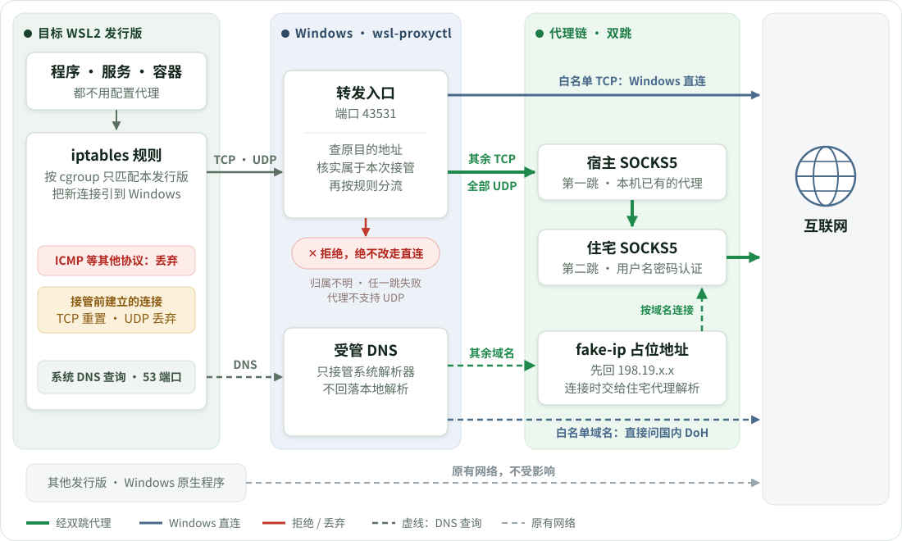

<div align="center">

# dick-wsl-proxy

**只接管一个 WSL2 发行版的出站流量：白名单 TCP 直连，其余经「宿主代理 → 住宅 SOCKS5」双跳，任何一跳失败都不会偷偷直连。**

Windows 桌面端 `wsl-proxy-desktop` · 控制器与命令行 `wsl-proxyctl`


[](https://github.com/JungleZy/dick-wsl-proxy/releases)

[](LICENSE)

简体中文 · [English](README.en.md)

</div>

> [!WARNING]
> **每次启动接管都会重启目标发行版。** 接管前会把目标的时区改成住宅出口所在时区，然后只重启这个发行版，里面正在运行的程序都会被结束。命令行的 `start` 没有确认步骤。动手之前请先读[使用前必读](#使用前必读)。

| 了解 | 上手 | 参考 | 开发 |
| --- | --- | --- | --- |
| [它解决什么问题](#它解决什么问题) | [系统要求](#系统要求) | [策略配置参考](#策略配置参考) | [从源码构建](#从源码构建) |
| [功能](#功能) | [安装](#安装) | [停止与故障恢复](#停止与故障恢复) | [项目结构](#项目结构) |
| [工作原理](#工作原理) | [桌面端上手](#桌面端上手) | [常见问题](#常见问题) | [文档导航](#文档导航) |
| [使用前必读](#使用前必读) | [命令行用法](#命令行用法) | [安全说明](#安全说明) | [参与开发](#参与开发) |
| | | | [许可证](#许可证) |

## 它解决什么问题

WSL2 的所有发行版共用 Windows 的网络出口。想让其中**一个**发行版的流量全部走住宅代理，常见做法要么是给每个程序单独配代理（总有漏掉的），要么是在 Windows 上开全局或 TUN 代理（连带影响其他发行版和 Windows 自己）。

dick-wsl-proxy 在 Windows 侧只接管你指定的那一个发行版：

- 目标里的程序不用配任何代理。命令行、后台服务、Docker 容器发出的新连接都会被接管。
- 其他发行版和 Windows 原生程序照旧走原来的网络。
- 不改 Windows 系统代理，不改 WSL 共享的 `resolv.conf` 和 `.wslconfig`，不在 WSL 里装代理软件或监听端口。
- 出问题时宁可断网，也不让流量绕开代理直连出去。只有你主动停止接管，网络才恢复原样。

它不是通用 VPN：只管你选定的 WSL2 发行版，后端只在 WSL2 NAT 网络模式下验证过。可以同时接管多个发行版，每个用自己的住宅代理和 Windows 入口端口，规则放在各自的 nft 表里，互不影响；同时接管的发行版里最多一个运行 Docker（它们共用一个网络栈，`docker0` 会冲突）。

## 功能

- **按发行版接管**：在目标里建本实例自己的 nft 表，按 cgroup 只匹配这个发行版的进程，把新连接引到 Windows 上的入口。别的发行版写防火墙规则改不动这张表。
- **白名单直连**：支持 IP、CIDR、精确域名、域名后缀四种写法，命中的 TCP 由 Windows 直接连。新建的配置库会预填一批国内常用服务的域名后缀。
- **双跳代理**：其余流量先经宿主机上已有的 SOCKS5 代理（第一跳），再经住宅代理（第二跳，用户名密码认证）出去。住宅代理可以是 SOCKS5，也可以是 HTTP 代理；HTTP 代理只能转发 TCP，选它时 UDP 全部拒绝。
- **失败不放行**：任何一跳失败，连接就失败；故障时保持阻断，不会降级成直连。
- **系统 DNS 接管**：目标的系统 DNS 由 Windows 处理，永远不回落到本地或运营商的解析器。白名单以外的域名默认用 fake-ip 交给住宅代理解析，白名单域名直接问国内 DoH。
- **UDP 与 QUIC**：经住宅代理的 UDP Associate 转发；代理不支持 UDP 时，本次接管期间这类 UDP 一律拒绝，不会直连。
- **IPv6**：目标有全局 IPv6 时一并接管，没有时把目标的外部 IPv6 全部阻断。
- **Docker 容器**：目标里 Docker bridge 网络的容器流量也经代理。
- **时区跟随出口**：接管时把目标的时区改成住宅出口所在时区，避免时区和 IP 对不上。
- **桌面端**：首页监控保护状态和流量；环境页管理发行版（新建、编辑、备份、删除、改时区）；规则、连接记录、运行日志、设置；托盘常驻。
- **崩溃可恢复**：接管状态写进恢复记录，控制器崩溃后端口仍被一个持有进程占着、规则保持阻断；用 `status` 和 `stop` 显式恢复。

## 工作原理



1. 启动接管时，控制器以 root 身份在目标里安装规则，把目标发出的新连接引到 Windows 在 WSL 虚拟网卡上监听的入口（默认端口 43531）。
2. 入口收到连接后，经一个只读查询进程向目标内核的连接跟踪表查原来的目的地址。查询进程由 `wsl.exe` 拉起，只走标准输入输出，不监听端口。查不到、或者核对后不属于本次接管，就拒绝，不猜目的地址。
3. 核实之后再按规则决定直连还是走双跳。

### 流量去向

| 流量 | 去向 |
| --- | --- |
| 命中白名单的 TCP | Windows 直接连接 |
| 其余 TCP（启用受管 IPv6 时含 IPv6） | 宿主 SOCKS5 → 住宅代理（SOCKS5 或 HTTP）；任何一跳失败，连接就失败 |
| UDP，含 QUIC，**白名单的也一样** | 经两跳代理的 UDP Associate；启动时探测不通过，本次接管期间一律拒绝，界面显示「UDP 已阻断」 |
| 系统 DNS（目标 `resolv.conf` 里的解析器，UDP/TCP 53） | 由 Windows 处理，见下一节 |
| 直接问其他 DNS 服务器的 53 端口（例如 `dig @1.1.1.1`） | 拒绝，既不经代理也不直连 |
| ICMP 等 TCP、UDP 以外的协议 | 丢弃 |
| IPv6 | 目标有全局 IPv6 地址和默认路由时按上面的规则接管；没有时，除回环外全部阻断 |

UDP 不直连是有意为之：网页可以借白名单里的 STUN 服务器，通过 WebRTC 拿到 Windows 的真实出口 IP。

**Docker 容器**：只认目标里 Docker 的 bridge 网络，接管中新建的网络最多约 30 秒后纳入。目标访问自己的容器、Windows 经 `localhost` 访问端口映射都照常可用；新建的网络同样要等纳入之后，例如 `docker compose up` 后的头几十秒。Podman 等其他运行时的容器不经代理，别的发行版的容器不受影响。启动接管时目标里的 Docker 在运行却读不出它的网络（例如 API 一直没响应），启动失败、进入「需要恢复」：这时目标本机的流量已阻断，但**目标的容器没有被拦住，可能直连**，直到你停止接管。

### DNS 怎么解析

- **白名单以外的域名默认用 fake-ip。** A 查询当场回一个 `198.19.x.x` 占位地址（TTL 1 秒），AAAA、HTTPS/SVCB 查询回空。程序连这个地址时，入口把域名交给住宅代理去解析。住宅代理不支持按域名连接时，本次接管自动不启用 fake-ip。
- **关闭 fake-ip 后**，这些查询经两跳代理去问策略里的 DoH 上游 `dns_upstream`。新建配置库预填的是 Google DoH（`8.8.8.8:443`、`dns.google`）。
- **白名单域名**直接由 Windows 问国内 DoH 上游，默认阿里 DNS（`223.5.5.5:443`、`dns.alidns.com`），让直连站点拿到国内地址。国内上游连不上或应答不可用时，改经两跳代理再问。返回给目标的是 `198.18.x.x` 别名地址，连这个别名的 TCP 才会直连。
- **缓存**：过期一小时内的旧应答会先返回（TTL 记 30 秒），同时在后台刷新。旧应答同样来自配置的上游，不算本地解析。

## 使用前必读

**1. 接管会改目标的时区，并重启目标。**
每次启动接管，都发生在预检通过、确认之后、装规则之前：

- Windows 经两跳代理访问 `my.ippure.com`，查住宅出口所在的时区；
- 把目标的时区改成它；
- 在目标的 `/etc/wsl.conf` 写 `[time] useWindowsTimezone=false`，不然下次 WSL 启动目标时会改回 Windows 的时区；
- 然后只重启这个发行版，里面正在运行的程序都会被结束。时区本来就对，也照样重启。

查不到时区，或者目标里缺这个时区的数据（`/usr/share/zoneinfo`），就不接管。停止接管不会把时区改回去。

**2. 接管前就建立的连接，在接管期间不能用。**
目标重启后、规则装上前就连上的程序（例如开机自启的 VPN、Tailscale）不会被代理，也不会继续直连：

- TCP 连接在下一次发包时被重置，程序重连后走代理；
- UDP 流的包被丢弃。WireGuard 这类固定端口的 UDP 程序会在整个接管期间都不通，接管后重启它也没用（端口不变，仍落在旧的连接记录上）。可以关掉它的开机自启，等接管开始后再启动，这样它和其他 UDP 一样经住宅代理（没实测）。

**3. 有全局 IPv6 的目标不能用域名白名单。**
这时策略里只要有域名或域名后缀白名单，启动就会被拒（`ipv6_domain_allowlist_unsupported`）。新建的配置库默认就带一批国内后缀，要先清空规则页的两列域名规则。被拒发生在改时区、重启目标之后。

**4. fake-ip 带来的两个现象。**
在目标里看到 `198.19.x.x` 地址是正常的。不存在的域名表现为连接失败，而不是「域名不存在」（NXDOMAIN）。

**5. 住宅代理的密码以明文保存。**
住宅服务器、用户名和密码保存在 EXE 同目录的 `desktop.sqlite` 里，没有额外加密，只靠 Windows 账户的文件权限保护。卸载不会删除它。不要把 `.env` 或密码提交到仓库。

**6. 程序退出不等于网络已恢复。**
关窗、强制结束进程、控制器崩溃都不会恢复直连，规则会一直保持阻断。要恢复，必须显式停止，见[停止与故障恢复](#停止与故障恢复)。

例外是目标或 WSL 重启：目标单独重启、空闲退出或执行 `wsl --shutdown` 后，本次接管的规则不再生效，目标的新连接会直连。后台约 30 秒一次的核对发现后，会在目标里改装一组只丢弃的规则（目标本机进程新发起的连接除回环外一律丢弃），首页显示「已在目标里断网」。断网时，接管期间记下的目标 Docker 网络转发出去的流量也一并丢弃；接管期间没见过的网络不在其内。从重启到下一次核对之间，最长约 30 秒会直连。后台不在时，由占着入口端口的持有进程做同样的事，你重新连接后由后台做。

**7. 隔离只在一个内核版本上实测过。**
「其他发行版不受影响」只在 WSL 内核 6.18.58.1 上实测过。目标内核低于这个版本或读不出版本时，预检直接阻断，需要先升级 WSL。升级后能不能过这道门槛，没有实测过。

**8. 发布包没有签名。**
SHA-256 校验值只能证明文件完整，不能证明是谁发布的。v0.1.11 之后的发布包另带 GitHub 构建来源证明，能核对它是本仓库的发布流水线构建的，但这也不等于代码签名，Windows 照样会提示来源未知。

## 系统要求

**Windows 侧**

- Windows x64。运行不需要管理员权限。
- 本机已有一个 SOCKS5 代理入口，作为第一跳。地址必须是回环 IPv4，且不需要认证，例如本机代理软件开放的 SOCKS5 端口。新建的配置库预填 `127.0.0.1:7892`。
- 一个住宅代理，使用用户名密码认证：SOCKS5，或 HTTP 代理（只转发 TCP，UDP 会全部拒绝）。
- 想让 UDP（含 QUIC）可用，住宅代理要选 SOCKS5，并且宿主代理和住宅代理**都**要支持 UDP Associate。任何一端不支持，接管照样启动，但 UDP 会被拒绝。

**目标发行版**

- WSL2，网络模式是 NAT。WSL1、mirrored、bridged 等模式不支持。
- WSL 内核不低于 6.18.58.1。
- systemd 是 PID 1。
- 有 `nft`（`nftables` 包）：规则写进本实例自己的 nft 表（决策 41），预检缺它时报 `tooling.nft_missing`；程序新建的环境会自动装上，已有的发行版要自己 `apt install nftables`。
- 有 `iptables-nft` 和 `ip6tables-nft`：用来找出并删除旧版本写在共用表里的规则。预检目前仍检查 `iptables-legacy` 和 `ip6tables-legacy`；Ubuntu 的 `iptables` 包两套都带。
- 内核能力：`xt_cgroup`、`nf_conntrack`、`nf_nat`、`iptable_nat`、`ip6table_nat`，以及 IPv4、IPv6 的 REJECT；nft 写入还要 `nft_compat`（WSL 内核以模块提供），这一项预检还没有检查。冷启动后缺这些模块时，可以让程序加载发行版里已有的模块，见下文。
- 有 `/usr/bin/python3`。注意：预检目前不检查这一项，缺了要到改完时区、重启目标之后才会失败。
- 有 `/usr/share/zoneinfo` 时区数据，以及 `awk`、`od`、`sha256sum`、`ip` 等基础命令。

## 安装

> [!NOTE]
> 预编译包从 [v0.1.11](https://github.com/JungleZy/dick-wsl-proxy/releases/tag/v0.1.11) 起发布在 GitHub Releases：v0.1.11 是预发布，v0.1.12 起是正式发布。包没有代码签名，第三方许可证的再分发义务还没人确认。更早的 `v0.1.4`–`v0.1.7` tag 没有发布包。

### 下载预编译包

发布流水线在推送 `v*` tag 时运行：在 GitHub 的 Windows 构建机上原生编译，跑完格式检查、clippy、全部测试、导入表检查和安装冒烟测试后打包，发布到 [GitHub Releases](https://github.com/JungleZy/dick-wsl-proxy/releases)。每个版本附两个文件：

- `wsl-proxy-<版本>-windows-x64.zip`：两个 EXE、安装与卸载脚本、构建记录和第三方许可证清单；
- `wsl-proxy-<版本>-windows-x64.zip.sha256`：校验值。

在 PowerShell 里：

```powershell
# 1. 核对校验值，和发布页上的值比较
Get-FileHash -Algorithm SHA256 .\wsl-proxy-<版本>-windows-x64.zip

# 可选：核对构建来源（v0.1.11 之后的版本，需要 GitHub CLI）
gh attestation verify .\wsl-proxy-<版本>-windows-x64.zip -R JungleZy/dick-wsl-proxy

# 2. 解压到一个新的目录（不要解压到安装目录里）
Expand-Archive .\wsl-proxy-<版本>-windows-x64.zip -DestinationPath .\wsl-proxy-<版本>
cd .\wsl-proxy-<版本>

# 3. 安装到当前用户，默认位置 %LOCALAPPDATA%\Programs\WslProxy
.\install.ps1
```

- 在允许运行该脚本的普通 PowerShell 里执行，不需要管理员权限。不要为此改执行策略来绕过本机限制。
- 可以用 `-InstallDir` 指定其他位置。目录有限制：本地盘、不超过 180 个字符、父目录归当前用户、SYSTEM 或 Administrators 所有。完整条件见 [M5 发布说明](docs/plans/m5/README.md)。
- 安装器只复制文件：不建快捷方式、不改 PATH、不写注册表。装完请打开安装目录里的 `wsl-proxy-desktop.exe`。

### 升级与卸载

1. **先停止接管，再关窗。** 安装器在有接管进行中、需要恢复、或安装目录里的桌面窗口还开着时会拒绝操作，而且从不结束任何进程。
2. **升级**：0.1.11 之后的版本可以在桌面端一键升级，见下文[检查更新与一键升级](#检查更新与一键升级)。手动升级：在新包的解压目录里，对同一个 `-InstallDir` 运行 `.\install.ps1`。降级默认拒绝，要加 `-AllowDowngrade`。
3. **卸载**：在解压目录里运行 `.\uninstall.ps1`。卸载只删程序文件，下面三样会留下：
   - 安装目录里的 `desktop.sqlite`，含明文住宅密码；
   - `%LOCALAPPDATA%\WSLProxyLab`，里面是控制锁、恢复记录和 DNS 别名账本；
   - 开机自启的注册表项。所以卸载前请先在「设置 › 桌面运行」关掉开机自启。

   要彻底清除，就手动删掉前两个目录。
4. 后台以管理员身份运行时，普通权限的 PowerShell 连不上它，安装器会报控制锁被占用、不改任何文件；这时在管理员 PowerShell 里运行脚本。
5. 文件替换中途被打断时，从完整的解压目录加 `-Recover` 重跑同一条命令。

### 自行编译

见下文[从源码构建](#从源码构建)。

## 桌面端上手

把 `wsl-proxy-desktop.exe` 和同一版本的 `wsl-proxyctl.exe` 放在同一个目录（安装后已经是这样），打开前者。第一次打开时，它会以当前用户身份在后台拉起 `wsl-proxyctl.exe` 作为常驻后台。

1. **设置**页：在「网络与 DNS」里确认宿主 SOCKS5 地址，按需修改 DNS，点「保存设置」。新装的程序要先保存一次，才能启动接管。
2. **规则**页：在 IP / CIDR、精确域名、域名后缀三列里按行填写直连规则，点「保存规则」。新建的配置库已预填一批国内常用服务的后缀。
3. **环境**页：点要接管的发行版，在详情的「接管」卡片里：
   - 选住宅代理的协议（SOCKS5 或 HTTP，按服务商给这个端口的类型选），填服务器 IPv4、端口、用户名、密码（密码明文显示）；
   - 「Windows 入口端口」留空时，保存时由程序从 43531 起分一个别的环境没用的端口，也可以自己填；
   - 点「保存住宅代理」。每个环境的住宅代理和入口端口分开保存，互不影响。
   - 想先确认住宅代理连得上，可以点「检测住宅代理」。它会弹确认框：直接连接那一路会把账号密码不经第一跳、明文发出去。
4. 点「启动接管」：环境列表每一行右边就有这个按钮，详情的「接管」卡片里也有。住宅代理没配置、或有页面没保存时，点了会直接说明原因。
   - 程序先自动预检。
   - 发行版里没有 `nftables` 时，会询问是否用 apt 装上；确认后装好、自动重新预检。
   - 缺内核模块时，会询问是否加载发行版里已有的模块。
   - 然后弹确认框，写明会改时区并重启目标。确认后开始接管。
   - 可以同时接管多个环境，各自启动、各自停止。同时接管的环境里最多一个运行 Docker：另一个在接管的环境已经管着容器网络时，启动一个正在运行 Docker 的环境会被拒绝。
5. **停止**：点环境列表那一行的「停止接管」，或那个环境「接管」卡片里的「停止接管」、首页的「停止接管」、托盘菜单的「停止全部接管」。

**新增环境**时要填默认用户名、默认用户密码和这个环境的住宅代理（协议、服务器、端口、用户名、密码），都填了「创建并设置」才能点；创建成功后住宅代理自动保存给新环境，入口端口由程序分配。

从 0.1.17 及更早的版本升级时，原来那一份住宅代理和入口端口会自动归到原来设为目标的发行版。那个发行版已经不在时，环境详情里会提示有一份「还没分给任何环境」的住宅代理，可以分给正在看的环境，或者丢弃。

### 六个页面

| 页面 | 用途 |
| --- | --- |
| 首页 | 接管概览：正在接管和需要恢复的环境（多个时每个一行，各有停止、恢复直连或放弃记录按钮）、保护链路、全部环境合计的流量图、事件时间线。主按钮随状态变化：去环境页 / 停止接管 / 停止全部接管 / 放弃本次记录 / 重新连接 |
| 环境 | 发行版列表（每行显示接管状态）与详情；详情里的「接管」卡片管这个环境的住宅代理、入口端口、检测、启动和停止；新增、编辑组件、改时区、备份、删除发行版（这五项要求当前没有接管） |
| 规则 | 直连规则三列：IP / CIDR、精确域名、域名后缀 |
| 连接 | 连接记录（已结束的连接保留最新 50,000 条）、「复核公网出口」、「导出脱敏诊断」、「重置 DNS 别名」 |
| 日志 | 运行日志，支持搜索，可按全部、错误、警告筛选 |
| 设置 | 网络与 DNS、转发限制、桌面运行（开机自启）、WSL 平台、关于（检查更新与升级） |

### 托盘与关窗

- **关窗只收进托盘，代理照常运行。** 托盘图标没能显示时（例如开机时 Explorer 还没就绪），点关闭会直接退出界面，后台保留。
- **看托盘图标就知道在不在接管。** 盾牌绿色、波形上有亮光循环扫过就是接管中；灰色静止是未接管；红色是需要恢复；琥珀色加一条平线是后台状态未确认（这时接管可能仍在生效）。悬停显示状态和目标发行版，多个环境在接管时写「N 个环境」；任一环境需要恢复时图标就是红色。
- 单击托盘图标打开主窗口。右键菜单顶部显示当前状态，主操作跟着状态变：未接管时「打开环境页」，接管中「停止全部接管」（确认一次后逐个停止每个在接管的环境），需要恢复时「去恢复接管」（打开那个环境的页面），后台没连上时「重新连接后台」，另有检测公网出口、查看连接记录、查看运行日志、开机自动启动。
- 托盘菜单的「退出」：空闲时直接关后台再退出；接管中先确认，再停止接管、恢复直连、关闭后台，最后退出。任何一步没完成都不会退出。
- 桌面被强制结束或崩溃时，后台照旧保留，重新打开就能连上。
- 同一时间只运行一个桌面窗口。再次打开会把已有窗口唤到前台。

### 冷启动后的内核模块

WSL 冷启动或重启后，共享内核可能还没加载所需的模块。启动接管前的预检发现缺少这些能力时，桌面会询问是否加载。确认后它会做三件事：

- 只加载目标 `/lib/modules` 里已有的模块，并注册空的 filter/nat 表；
- 把模块列表写进 `/etc/modules-load.d/wsl-proxy.conf`；
- 写入并启用一个 `wsl-proxy-tables.service`，以后 WSL 启动时自动准备好。

它不安装软件包，也不改 `.wslconfig`。0.1.11 起还需要 REJECT 模块（用来重置旧连接），用旧版本准备过的内核会再询问一次。目标内核低于 6.18.58.1 时不会询问，因为加载模块解决不了，需要先升级 WSL。详见 [M6](docs/plans/m6/README.md)。

### WSL 平台与升级

「设置 › WSL 平台」只读显示 `wsl.exe` 版本、WSL2 内核、默认版本和已注册的发行版。没有接管时，可以从这里显式运行 `wsl --update`。注意：

- 它会终止所有发行版；
- 最多等 30 分钟，超时会结束升级进程，WSL 可能停在升级到一半；
- 等待期间不要关闭程序、退出后台或做别的环境操作，否则结果可能看不到，或被误报为失败；
- 失败、超时或没看到结果时，在 PowerShell 里用 `wsl --version` 核对，必要时自己再运行一次 `wsl --update`。

详见 [M7](docs/plans/m7/README.md)。

### 检查更新与一键升级

「设置 › 关于」的「更新」一组：

- **检查**：打开程序 15 秒后查一次 GitHub 上的新版本，之后每天一次；也可以点「检查更新」。配置了宿主 SOCKS5 就经它查，连不上再直连，不经住宅代理。每次检查都会让 GitHub 看到你的出口 IP；不想让程序自己联网，就关掉「自动检查更新」。
- **提醒**：发现新版本时弹一次提醒，底部状态栏版本号旁边显示「有新版本」。
- **升级**：点「升级到 vX」并确认后，程序下载安装包（约 41 MB）、核对发布页公布的 SHA-256，然后关闭窗口，运行新包里的 `install.ps1`，装好后自动重新打开，并显示升级结果。窗口关闭后通常要一两分钟才重新打开，期间看不到进度；不要自己打开程序，否则安装器会拒绝这次升级（打开的窗口会显示原因）。

能一键升级的条件如下。前两条不满足时，「升级」按钮置灰，旁边写明原因；执行策略在点了「升级」之后才检查，不允许时提示原因，不会下载：

- 没有接管、也不需要恢复（先在首页停止接管）；
- 当前程序是用 `install.ps1` 装的（直接解压运行或自己编译的不行）；
- PowerShell 当前的执行策略允许运行本机脚本（RemoteSigned、Unrestricted 或 Bypass）。程序不会为此改执行策略或绕过它；策略是 Restricted 时，请从发布页手动升级。

安装包没有签名：SHA-256 只能发现下载损坏，证明不了发布者是谁，这和手动从发布页下载是同一个信任前提。升级只替换程序文件，配置库、开机自启和恢复记录都保留。升级没有完成时，重新打开的窗口会给出原因和可以手动运行的命令；文件替换中途中断时，程序不会自己重新打开，弹窗里给出 `-Recover` 命令。详见 [M8](docs/plans/m8/README.md)。

### 环境管理

环境页可以新建发行版（默认 Ubuntu-24.04，可选装 zsh、Chrome、中文输入法），也可以编辑组件、改时区、备份到文件、删除。

- 新建的发行版（带 `apt-get` 的，如 Ubuntu、Debian）系统语言是 `LANG=en_US.UTF-8`、`LANGUAGE=en_US:en`，不设 `LC_ALL`；里面的 Chrome 语言（`navigator.language`）和 Intl 区域都是 en-US（没用桌面端实际新建发行版实测）。中文输入法只加装 fcitx5 拼音和 zh_CN 语言包，不改默认语言，拼音仍是默认输入法；
- 编辑时勾了 Chrome 或中文输入法，保存会把系统语言改成上面的 en_US；
- 编辑组件、改时区会重启发行版；
- 删除会注销发行版，并删除其中的全部文件；
- 读取环境详情会启动没在运行的发行版。

## 命令行用法

所有操作也都能用 `wsl-proxyctl.exe` 在 PowerShell 里完成。

> [!NOTE]
> 除 `rpc` 外，命令行子命令都要先拿当前 Windows 账户唯一的控制锁。桌面后台在运行时，它们会报 `controller_busy`（退出码 3）。这时改用 `rpc` 把请求交给后台，或者先从托盘退出桌面端。

### 预检

```powershell
$ctl = '.\wsl-proxyctl.exe'
& $ctl list                        # 列出已注册的发行版，不启动任何发行版
& $ctl preflight Ubuntu-24.04      # 只读预检；换成 list 里的名字
```

`preflight` 可能唤醒目标，但不装任何规则。看输出 JSON 里的 `passed` 和 `blockers`：`passed: true` 只表示检查通过，不表示代理已经启用。退出码 0 表示通过，2 表示被阻断。

如果阻断项里有 `capability.kernel.*` 或 `baseline.ip*tables*`，说明共享内核处于冷启动状态，可以加载模块后重新预检：

```powershell
& $ctl prepare-kernel Ubuntu-24.04 --confirm
& $ctl preflight Ubuntu-24.04
```

`prepare-kernel` 要求当前没有接管，效果和桌面端的询问一样。要取消开机加载：先在目标里运行 `systemctl disable wsl-proxy-tables.service`，再删除 `/etc/modules-load.d/wsl-proxy.conf` 和 `/etc/systemd/system/wsl-proxy-tables.service`。

### 导入住宅代理设置

住宅代理按环境保存，导入时用 `--target` 指定发行版（名称或注册表 GUID）。准备一个 `.env` 文件。必须有下面四个键，`ip` 必须是 IPv4；住宅代理是 HTTP 代理时另加一行 `protocol=http`（不写就是 `socks5`），这时 `username` 不能含冒号：

```ini
ip=203.0.113.10
port=1080
username=user01
password=change-me
```

```powershell
& $ctl import-credential --name my-residence --target Ubuntu-24.04 --env-file D:\path\to\residential.env
```

设置写进 EXE 同目录的 `desktop.sqlite` 里这个环境的那一行，密码是明文；环境第一次保存时，同时从 43531 起分给它一个入口端口。`--name` 只是记进策略的标签。不再使用时，可以用 `forget-credential --name my-residence --target Ubuntu-24.04` 清空这个环境的住宅代理；正在接管这个环境时不能清。不带 `--target` 的 `forget-credential` 只丢弃旧版本留下、还没分给任何环境的那一份。

### 启动、查看、停止

准备一份策略 JSON（字段见[策略配置参考](#策略配置参考)），然后进入会话模式，逐行提交 JSON 命令：

```powershell
& $ctl session
```

```jsonl
{"command":"start","target":"Ubuntu-24.04","profile":"D:\\path\\to\\policy.json"}
{"command":"status"}
{"command":"stop"}
```

- `start` 的流程是：预检 → 同步时区并重启目标（**没有确认步骤**） → 再预检 → 装规则 → 就绪探测。DNS 和 HTTPS 就绪探测都通过才返回 `forwarding_managed`。任何一步失败都进入「需要恢复」状态，要显式 `stop`。
- `profile` 也可以指向 EXE 同目录的 `desktop.sqlite`。这时桌面端必须先保存过一次设置，只用命令行导入不算，否则报 `desktop_store_not_saved`；目标还要有自己保存好的住宅代理，否则报 `residential_credential_incomplete`。
- 住宅代理总是用目标自己的那一份，策略文件也一样。不写 `port` 时，`desktop.sqlite` 用这个环境保存的入口端口，策略文件用 43531。
- 会话的标准输入关闭（EOF）时，也会停止接管。

### 子命令一览

| 子命令 | 作用 |
| --- | --- |
| `list` | 列出发行版，只读，不唤醒任何发行版 |
| `preflight <目标> [--port 43531]` | 只读预检，可能唤醒目标 |
| `prepare-kernel <目标> --confirm` | 加载已有模块、注册空表、写开机配置；要求这个目标没在接管 |
| `wsl-platform` | 只读报告 WSL 平台信息 |
| `wsl-platform-update --confirm` | 运行 `wsl --update`；要求空闲，会终止所有发行版 |
| `start <目标> --profile <策略> [--port <端口>]` | 用目标自己的住宅代理启动接管（会改时区并重启目标），之后留在前台，标准输入关闭时停止；已有接管时拒绝 |
| `status` | 输出各环境的状态 JSON：`{"sessions":[...]}`，每项带 `scope`（发行版 GUID）和这个环境的阶段、操作代次 |
| `stop [--target <目标>] [--expected-generation <N>]` | 停止一个环境的接管或执行恢复；只有一个环境在接管时可以不写 `--target`；空闲时重复执行仍成功 |
| `abandon --confirm [--target <GUID>]` | 目标已被注销、`stop` 无法完成时，放弃它的记录；还有别的环境在接管时，顺带在那个环境里删掉它的规则表 |
| `import-credential --name <标签> --target <目标> --env-file <路径>` | 导入一个环境的住宅代理设置 |
| `forget-credential --name <标签> [--target <目标>]` | 清空一个环境的住宅代理；不带 `--target` 时丢弃未分配的那一份 |
| `reset-dns-aliases --confirm` | 白名单域名的别名地址用尽时清空账本；要求空闲 |
| `session` | 会话模式：逐行读 JSON 命令，标准输入关闭时停止接管 |
| `rpc` | 从标准输入读一条 JSON 请求，交给正在运行的桌面后台 |

`status` 里每个会话的 `phase` 有四种取值：`idle`（空闲）、`forwarding_managed`（接管中）、`forwarding_scoped`（诊断模式）、`recovery_required`（需要恢复）。更多细节见 [M2](docs/plans/m2/README.md)、[M3](docs/plans/m3/README.md)。

## 策略配置参考

策略是一份 JSON 文件，上限 1 MiB，未知字段会被拒绝。最小示例：

```json
{
  "first_hop": "127.0.0.1:7892",
  "credential": "my-residence",
  "dns_upstream": "8.8.8.8:443",
  "dns_tls_name": "dns.google",
  "direct_ips": [],
  "direct_domains": [],
  "direct_suffixes": []
}
```

| 字段 | 必填 | 默认值 | 说明 |
| --- | --- | --- | --- |
| `first_hop` | 是 | | 第一跳 SOCKS5，必须是回环 IPv4:端口 |
| `credential` | 是 | | 住宅设置的标签，不参与查找 |
| `dns_upstream` | 是 | | 经两跳代理访问的 DoH 上游，写 IPv4:端口 |
| `dns_tls_name` | 是 | | 上游的 TLS 主机名，用于证书校验 |
| `direct_ips` | 是 | | 直连的 IP 或 CIDR，IPv4、IPv6 都可以；CIDR 要写网络地址 |
| `direct_domains` | 是 | | 直连的精确域名 |
| `direct_suffixes` | 是 | | 直连的域名后缀，同时匹配它自己和所有子域 |
| `health_domain` | 否 | `ippure.com` | 就绪探测访问的 HTTPS 域名，不能命中白名单 |
| `fake_ip` | 否 | `true` | 白名单以外的域名用占位地址、交给住宅代理解析 |
| `direct_dns_upstream` | 否 | `"223.5.5.5:443"` | 白名单域名用的国内 DoH，必须是公网 IPv4:端口；写 `null` 关闭 |
| `direct_dns_tls_name` | 否 | `dns.alidns.com` | 国内 DoH 的 TLS 主机名 |
| `max_tcp_connections` | 否 | `256` | 并发 TCP 上限（含 DNS over TCP），16–1024；满了直接拒绝新连接，不排队 |
| `tcp_idle_timeout_seconds` | 否 | `1800` | 两个方向都没有数据多久后断开，30–86400 |
| `tcp_half_close_timeout_seconds` | 否 | `60` | 一方结束后另一方多久没数据就断开，5–3600 |

- 入口端口不写在策略里。用 `--port` 指定，必须不小于 1024；不指定时，`desktop.sqlite` 用这个环境保存的端口，策略文件用 43531。
- 白名单不能命中 `my.ippure.com`（时区查询要经代理）和 `health_domain`。
- 桌面端的设置页、规则页就是这份策略的图形界面，保存在 `desktop.sqlite` 里；住宅代理和入口端口不在策略里，按环境保存在同一个库。

## 停止与故障恢复

**正常停止**

- 桌面端：那个环境详情里的「停止接管」、首页「停止接管」，或托盘「停止全部接管」。
- 命令行：在原会话里发送 `{"command":"stop"}`。

**窗口已关、后台还在运行**

在安装目录里，经后台停止：

```powershell
$ctl = Join-Path $env:LOCALAPPDATA 'Programs\WslProxy\wsl-proxyctl.exe'
$state = '{"command":"status"}' | & $ctl rpc | ConvertFrom-Json
@{command='stop'; expected_generation=$state.operation_generation} | ConvertTo-Json -Compress | & $ctl rpc
'{"command":"status"}' | & $ctl rpc
```

恢复到 `idle` 后，可以发送 `{"command":"shutdown_daemon"}` 让后台退出。

**控制器崩溃之后**

在一个新的 PowerShell 里依次运行：

```powershell
& $ctl status    # 应显示 recovery_required；可能唤醒目标
& $ctl stop      # 撤规则、删映射、释放端口、删除恢复记录
```

期望结果是 `phase` 为 `idle`、`active_target` 为 `null`。`controller_busy` 表示另有程序持锁，不代表已经恢复。

**目标在接管中被注销**

`stop` 会报 `journal_distribution_no_longer_matches_registration`。这时运行 `& $ctl abandon --confirm --target <GUID>`（桌面端是首页的「放弃本次记录」）。还有别的环境在接管时，后台会在那个环境里按表名删掉被放弃环境的规则表；没有别的环境在接管时，再执行一次 `wsl --shutdown`，清掉 WSL 里可能残留的规则。

> [!IMPORTANT]
> 不要手动删除 `%LOCALAPPDATA%\WSLProxyLab` 里的 `m1-active.json`、`m3-operation.json`，也不要清空共享的防火墙规则或连接跟踪表。删掉恢复记录不会恢复网络，只会让程序失去恢复所需的信息。

## 常见问题

**目标里的域名解析成 `198.19.x.x`，正常吗？**
正常，这是 fake-ip 的占位地址。程序连这个地址时，入口会把真实域名交给住宅代理去解析。白名单域名则会解析成 `198.18.x.x` 别名地址。

**访问一个不存在的域名，为什么报连接失败，而不是「域名不存在」？**
开启 fake-ip 时，所有白名单以外的域名都先拿到一个占位地址，要等住宅代理去解析时才知道域名不存在。想要原来的行为，可以在设置页「网络与 DNS › 远端解析」关掉，或在策略里写 `"fake_ip": false`。

**界面显示「UDP 已阻断」？**
住宅代理选的是 HTTP 时，这是预期结果：HTTP 代理只能转发 TCP。否则说明启动时的 UDP 探测没通过：宿主代理或住宅代理至少有一个不支持 UDP Associate。本次接管期间所有 UDP（含 QUIC）都被拒绝，不会直连；TCP 和系统 DNS 不受影响。下次启动时会重新探测。

**白名单里的网站，为什么 UDP 也走代理？**
防止 WebRTC 泄露真实出口 IP。网页会向 STUN 服务器发 UDP 请求，借此拿到自己的公网地址；如果白名单里的 STUN 服务器能被直连，网页就能看到 Windows 的真实出口 IP。

**为什么目标被重启了、时区也变了？**
这是接管流程的一部分，见[使用前必读](#使用前必读)第 1 条。

**启动报 `ipv6_domain_allowlist_unsupported`？**
目标有全局 IPv6，而策略里有域名或域名后缀白名单。清空规则页的两列域名规则后再启动。

**命令行报 `controller_busy`？**
桌面后台或另一个会话正持有控制锁。改用 `'{"command":"status"}' | .\wsl-proxyctl.exe rpc`，或者先从托盘退出桌面端。

**`dig @8.8.8.8 example.com` 这样直接指定 DNS 服务器会失败？**
是的。目标里只有系统解析器的查询会被接管；直接发往其他 DNS 服务器 53 端口的查询会被拒绝，既不经代理也不直连。程序自带的 DoH/DoT 是普通 TCP 连接，照常走代理。

**预检阻断，提示内核低于 6.18.58.1？**
需要先升级 WSL：桌面端在「设置 › WSL 平台」，或在 PowerShell 里运行 `wsl --update`。

**关掉窗口后，代理还在运行吗？**
在。关窗只是收进托盘，后台继续持有接管。要停止，用首页的「停止接管」或托盘菜单。

**卸载后怎么彻底清除？**
先在设置里关掉开机自启，再卸载，然后手动删除安装目录（含 `desktop.sqlite`）和 `%LOCALAPPDATA%\WSLProxyLab`。目标里的 `/etc/wsl.conf` 时区设置、`/etc/modules-load.d/wsl-proxy.conf` 和 `wsl-proxy-tables.service` 需要在发行版里自己删除。

## 从源码构建

最终的编译、测试和打包都要在 Windows 上，用 Windows 的 Rust 工具链完成。控制器和桌面端都是 Windows 程序，很多代码在 Linux 上不参与编译，所以在 WSL 里编译通过说明不了 Windows 版本能用。

**准备**

- Rust stable，host 是 `x86_64-pc-windows-msvc`。项目使用 Rust 2024 edition；仓库没有固定最低版本，维护者用的是 1.100.0。
- Visual Studio 的 C++ 生成工具。
- Windows SDK：编译桌面端时要用其中的 `fxc.exe` 编译着色器，也可以用环境变量 `GPUI_FXC_PATH` 指定位置。
- 不要设置 `RUSTFLAGS`。仓库的 `.cargo/config.toml` 为 MSVC 目标开启了静态 C 运行库（`+crt-static`），设了 `RUSTFLAGS` 这项配置就不生效，编出的 EXE 会依赖 VC++ 运行库。
- 打包需要 Python 3.11 或更高版本。

**构建与测试**（在仓库根目录的 PowerShell 里）

```powershell
cargo build --locked --release                                       # 只编控制器 wsl-proxyctl
cargo build --locked --release -p wsl-proxyctl -p wsl-proxy-desktop  # 控制器加桌面端
cargo test --locked --workspace
```

产物在 `target\release\`。默认的 Cargo 成员只有控制器，只编命令行时不需要编译 GPUI。

**打包**

发布包的打包步骤以 [`.github/workflows/release.yml`](.github/workflows/release.yml) 为准：先检查导入表，再导出只含 Windows 平台依赖的 `cargo metadata`（`--filter-platform x86_64-pc-windows-msvc`）、写构建记录，然后用 `scripts/package-windows.py` 打包，最后跑安装冒烟测试；另一个 job 用 `cargo-deny` 按仓库根目录的 `deny.toml` 检查第三方许可证。包里的 `THIRD-PARTY-NOTICES.json` 和 `licenses/` 只收 Windows 版依赖图里的包（宁多勿漏），包自己没带许可证文件的，附它声明的许可证的标准全文（`packaging/licenses/`）。各脚本的参数和本机验收记录见 [M5](docs/plans/m5/README.md)。脚本拒绝覆盖已有的输出文件；`work/`、`dist/` 不在 `.gitignore` 里，建议输出到仓库外的目录。

在 WSL 里可以用 `scripts/build-desktop-windows.sh` 交叉编译出 Windows EXE，但这只算开发中途的检查，产物不能进发布包。

## 项目结构

```text
src/                  控制器 wsl-proxyctl
  command.rs, main.rs   命令行与会话命令
  controller*, transition*  接管的启停与恢复记录
  ingress*              Windows 入口：TCP、UDP 与 IPv6 转发
  managed_dns*          受管 DNS：缓存、fake-ip、白名单别名账本
  policy*               策略解析、双跳拨号、国内域名后缀清单
  query_bridge*         经 wsl.exe 向目标内核查原目的地址
  ipc*                  桌面端与后台之间的命名管道
  environment*          发行版管理与时区同步
  guest/                在目标里运行的脚本：规则、预检、内核准备、探测
desktop/              GPUI 桌面端 wsl-proxy-desktop
packaging/windows/    install.ps1、uninstall.ps1、common.ps1
scripts/              打包、构建记录、导入表检查、发布说明、安装冒烟测试
.github/workflows/    release.yml 发布流水线
CHANGELOG.md          每个版本的中文变更，发布说明的「变更」取自这里
docs/                 架构、决策、开发计划、讨论、审查
design/               桌面端界面规范与早期原型
```

## 文档导航

| 文档 | 内容 |
| --- | --- |
| [接管架构](docs/arch/README.md) | 现行设计与隔离边界 |
| [设计决策](docs/decisions.md) | 编号固定的决策登记，被取代的保留原条目 |
| [讨论](docs/discussions/) | 方案论证过程；定下来的结论并入架构并登记决策 |
| [审查](docs/review/) | 项目、代码与界面的审查记录 |
| [开发计划](docs/plans/README.md) | 里程碑、验收条件与执行记录 |
| [M0：目标识别与预检](docs/plans/m0/README.md) | 发行版枚举、身份识别、只读预检 |
| [M1：可逆的业务入口](docs/plans/m1/README.md) | 规则安装、连接归属核对、崩溃恢复 |
| [M2：双跳、白名单与 DNS](docs/plans/m2/README.md) | 策略 JSON、凭据导入、会话命令、分流与故障语义 |
| [M3：切换与恢复](docs/plans/m3/README.md) | 切换顺序、操作代次、异常恢复 |
| [M4：桌面端](docs/plans/m4/README.md) | 桌面操作、后台与故障边界、住宅代理检测 |
| [M5：发布与兼容性](docs/plans/m5/README.md) | 安装、升级、卸载、支持范围、性能实测、发布流水线 |
| [M6：内核环境准备](docs/plans/m6/README.md) | 冷启动后加载已有模块、注册空表 |
| [M7：WSL 平台检查与升级](docs/plans/m7/README.md) | 只读检查与显式 `wsl --update` |
| [M8：检查更新与一键升级](docs/plans/m8/README.md) | 查 GitHub 新版本、下载核对、交给安装器升级 |
| [M9：按环境配置住宅代理](docs/plans/m9/README.md) | 每个环境自己的住宅代理和入口端口、在环境页启动和停止（决策 40 第一期） |
| [界面设计规范](design/ui-design-spec.md) | 桌面端界面现状，以代码为准 |

## 参与开发

欢迎提 Issue 和 Pull Request。提交的代码和文档按本项目的 [MIT 许可证](LICENSE)授权。动手之前请先读 [AGENTS.md](AGENTS.md)，要点如下：

- **验证必须在 Windows 上做。** 最终的编译、测试、运行都要用 Windows 的 Rust 工具链，构建同一份工作区代码。WSL 里的 `cargo build`、`cargo test` 和交叉编译只算中途检查，不能写成「已通过」。
- **提交前跑一遍流水线里的检查：**

  ```powershell
  cargo fmt --all --check
  cargo clippy --locked --workspace --all-targets -- -D warnings
  cargo test --locked --workspace
  python src/guest/test_kernel.py
  python src/guest/test_https_probe.py
  python src/guest/test_kernel_env.py
  python scripts/test_package_windows.py
  cargo deny --workspace check licenses   # 先装一次：cargo install cargo-deny --locked
  ```

- **文档规矩：**
  - `docs/arch/` 只写现行设计；
  - 讨论放 `docs/discussions/`，审查记录放 `docs/review/`；
  - 定下来的决策登记在 `docs/decisions.md`；
  - 文件名写成 `日期-类别-内容.md`，不用提交号；
  - 举例不用真人的名字。
- **不要提交** `.env`、密码或任何住宅代理凭据。

## 安全说明

- 住宅代理凭据以明文保存在 EXE 同目录的 `desktop.sqlite`，只靠 Windows 账户的文件权限保护。
- 桌面端和后台之间的命名管道只接受同一 Windows 账户、且完整性级别不低于后台自身的进程（[决策 21](docs/decisions.md)）。后台以管理员身份运行时，普通权限的进程连不上它。
- 「检测住宅代理」里直接连接的那一路，会把住宅代理的用户名和密码不经第一跳、明文发出去，住宅服务商也会看到真实 IP。所以检测前会先弹确认框。
- 「导出脱敏诊断」只保留状态和数值计数，不含目的地址、域名和凭据，但仍请按内部资料处理。
- 发布包没有签名，第三方许可证的再分发义务还没人确认；v0.1.12 起仍作为正式版本发布，这两点写在每个版本发布说明的「已知限制」里。v0.1.11 之后的发布包带 GitHub 构建来源证明，见[安装](#安装)。
- 本项目不防御本机管理员，也不防御目标发行版里的 root。

## 许可证

本项目以 [MIT 许可证](LICENSE)发布，版权归 JungleZy 所有。

发布包里另附第三方依赖的许可证：`THIRD-PARTY-NOTICES.json` 列出 Windows 版依赖图里的每个包和它的许可证，`licenses/` 目录放对应的许可文本。包自己没带许可证文件的，附的是它声明的许可证的标准全文。依赖的许可证由发布流水线用 `cargo-deny` 按 [`deny.toml`](deny.toml) 检查。
